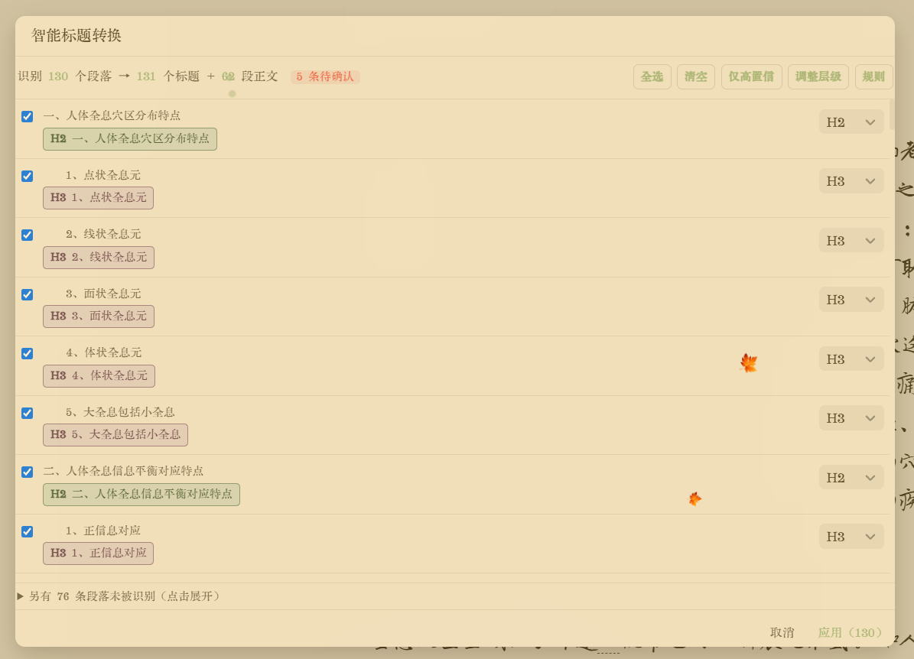
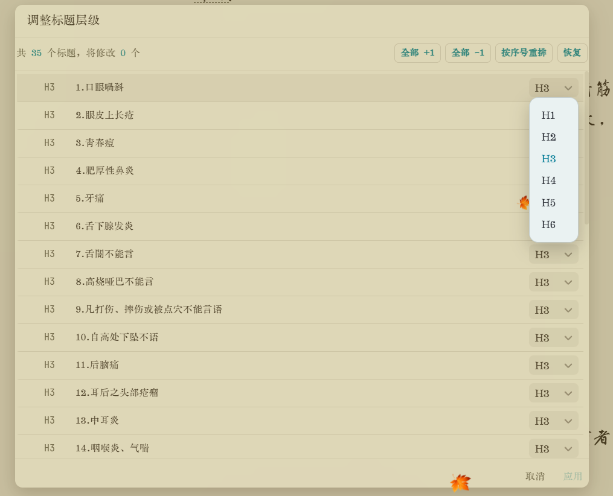
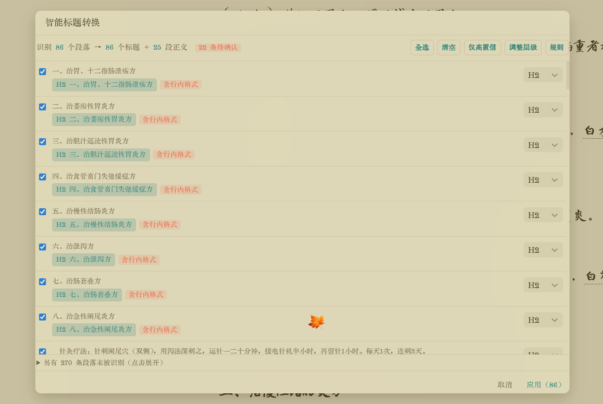
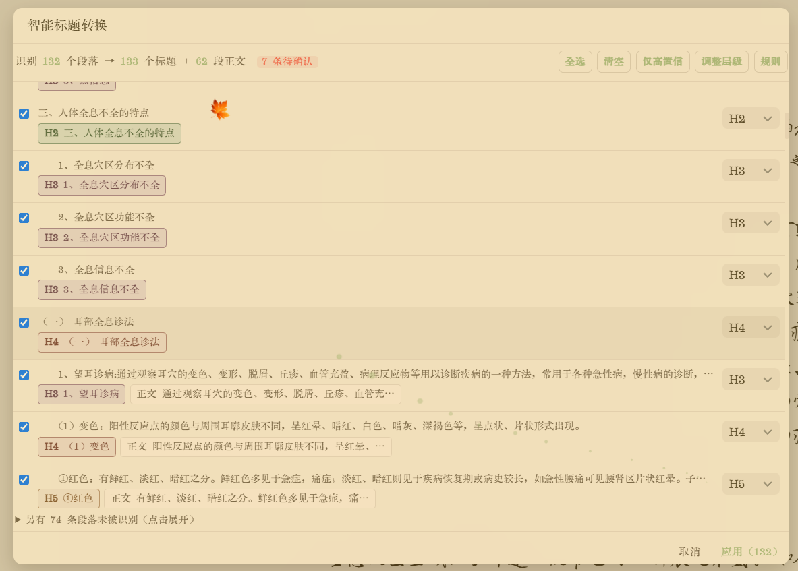
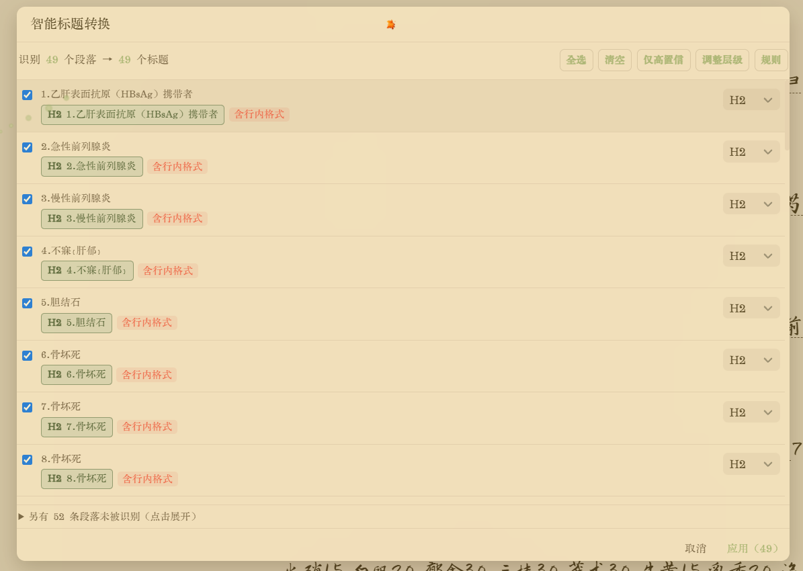

# 智能标题 Heading Master

> **本项目永久免费、完整开源。**  
> 所有功能对所有用户一视同仁：无付费版、无内购、无广告、无功能阉割、不设登录，以后也不会改成收费版或「基础版 / 专业版」。源码以 MIT 协议公开，欢迎自取、修改、二次分发，不必知会我。

自动识别带中文/数字序号的段落，一键转为分级标题；标题混在正文里时，自动另起一行拆出来。没有序号的小标题也认两类——独立成段的短句（`建立人体简单化的形象`）和 `第一个：…` 这种带次第的写法；剩下 2~3 字的纯文字标签（功效、组成…）可以自定义关键词词表。已经有标题、只是层级不对的，也能批量调整。

## 安装

- **集市**：思源 → 设置 → 集市 → 插件 → 搜索「智能标题」→ 安装并启用
- **手动**：下载 Release 里的 `package.zip`，解压到 `工作空间/data/plugins/heading-master/`，重启思源后在「已下载」里启用

需要思源 **3.8.4** 或更高版本。

## 用法

四种入口，前三种打开的是同一个预览面板：

| 入口                   | 范围     |
| -------------------- | ------ |
| 顶栏「H」按钮              | 当前文档全文 |
| 块标菜单 → 智能标题：转换选中块    | 选中的块   |
| 命令面板 → 智能标题：转换当前文档   | 当前文档全文 |
| 集市 → 已下载 → 智能标题 → ⚙️ | 打开设置面板 |

预览面板里每条都能单独勾选、单独改级别，确认无误再点「应用」。**不会盲改。**



### 层级配色（莫兰迪）

六个层级各用一种低饱和的莫兰迪色调，**靠色相区分层级、靠浓淡区分轻重**：

| 层级 | 色调  | 层级 | 色调  |
| -- | --- | -- | --- |
| H1 | 雾蓝  | H4 | 豆沙  |
| H2 | 鼠尾草 | H5 | 赭石  |
| H3 | 藕荷  | H6 | 石板灰 |

色块底色浓度从 H1 的 23% 递减到 H6 的 13%，基色明度从 30% 递增到 40%——层级越高颜色越实、越深，往下逐渐退回背景色，轻重一眼可读。所有色相都压在 HSL 饱和度 10%–34%、明度 30%–40% 的低彩度区间里，所以是莫兰迪的灰调，不是纯色块。

| 位置           | 颜色含义                         |
| ------------ | ---------------------------- |
| 转换预览的色块      | 这次要写入的级别                     |
| 调整层级面板的行首徽标  | 该行「改完之后」的级别（徽标文字写 `H原级→H新级`） |
| 调整层级面板的行左侧竖条 | 同徽标；待修改的行仍是主色条 + 淡色底         |

配色不写死最终色值，走 `color-mix` 与当前主题的前景/背景混合，**明暗主题自动适配**（暗色另给一套明度 60%–70% 的同色相基色）。实测对比度：浅色 5.03–7.25，暗色 4.64–6.55；相邻层级色差 ΔE 14–43，远高于可辨阈值。

集市卡片上的齿轮打开的是设置面板：分级策略、是否拆段、是否禁止跳级、标题最长字数、自定义关键词、各类识别开关都在这里改，**改动即时保存**。面板底部有「打开转换面板」按钮，点一下直接跳到预览。

预览面板的「规则」区也能改同一份配置。改自定义关键词时列表会**实时重算**（停手约 0.3 秒后刷新），不用关了重开。

## 调整已有标题层级

文档里已经有标题、只是级别不对（全是 H3、或者整体偏深），用这个入口批量改：

| 入口                     | 范围     |
| ---------------------- | ------ |
| 命令面板 → 智能标题：调整标题层级     | 当前文档   |
| 块标菜单 → 智能标题：调整选中块的标题层级 | 选中的块   |
| 转换面板 → 「调整层级」按钮        | 跟随当前范围 |
| 设置面板 → 「调整标题层级」按钮      | 当前文档   |



面板按层级缩进列出所有标题，每一行都能单独选目标级别。四个批量操作：

- **全部 +1 / 全部 -1**：整体升降一级
- **按序号重排**：按序号体系重新分级（`第一章`→H1，`一、`→H2，`1.`→H3…），没有序号前缀的标题保持原级并重置上下文
- **恢复**：回到文档当前的级别

待修改的行底色标蓝、行首徽标加粗并写成 `H5→H3`，一眼看出从哪到哪（徽标颜色按改后的级别）。底部「应用（N）」只写入真正变化的 N 个，没改的不动。

**标题里的加粗、链接不会丢** —— 写入用的是 kramdown 原文，不是纯文本。

应用前同样会存整篇快照，回退走「智能标题：撤销上次转换」。

举例（4 个标题全是 H3）：

```
H3 第一章 总论   → 按序号重排 →  H1
H3 一、总则                    →  H2
H3 1.风寒感冒                  →  H3（本来已是，不动）
H3 二、**组成**                →  H2（加粗保留）
```

## 识别哪些序号

| 形态         | 示例          | 默认级别            |
| ---------- | ----------- | --------------- |
| 方括号标签      | 【药性】辛，温。    | 按上下文（无上级标题时 H2） |
| 第X编/篇/章/部分 | 第三章 方剂的分类   | H1              |
| 第X节        | 第二节 常用治法    | H2              |
| 中文数字       | 一、总则　一.总则   | H2              |
| 括号中文数字     | （一）相须　一）相须  | H3              |
| 阿拉伯数字      | 1.风寒感冒　1、相须 | H4              |
| 括号阿拉伯数字    | （1）风寒表证     | H5              |
| 圈号         | ① ② ③       | H6              |
| 多级阿拉伯      | 1.1 / 1.1.1 | H3 / H4         |

`一、` 这类中文数字默认落 H2。下面这篇 8 个方名一次识别完，右侧可逐条改级别：



**【标签】的处理是特殊的**：方括号连同里面的字整体作为标题，后面全部算正文，不再按句号切分。所以 `【药性】辛，温。归肺、胃经。` 会变成标题 `【药性】` + 正文 `辛，温。归肺、胃经。`（不会把「辛，温」误当成标题）。方括号出现在句子中间也会切开，例如 `本品为麻黄科植物。草麻黄【应用】…`。

`0.5～1.5g`、`3.14` 之后紧跟数字的写法不会被识别成序号（唯一例外：`3.14 是圆周率` 这种「数字+空格」会被当成 `1.1` 式多级序号，预览里取消勾选即可）。全角数字 `１．` 与半角等价。

## 无序号标题（短段落 / 第X个）

没有序号、也不是固定标签的标题，按「形状 + 整篇分布」判断，默认开启：

| 形态        | 示例            | 判据                                       |
| --------- | ------------- | ---------------------------------------- |
| 独立短段落     | `建立人体简单化的形象`  | 4–20 字、无句号分号逗号冒号、不以虚词收尾、不是列表中的一行         |
| 第X个 / 第X， | `第一个：学习中医的发心` | 「第X(个/项/点)」后必须是冒号或顿号；「第X，」后紧跟的那一句要短且不带逗号 |

两条规则都**整篇一起看**：全篇至少出现 2 条同类结构才启用，零星一条不动，避免普通文章被误转。字数上限可在「规则 → 短段落判定字数」里改。

### 短段落排除哪些

药材行、药量行、加粗行同样短、同样没有句号，靠下面这些特征排除：

| 原文                  | 结果  | 原因              |
| ------------------- | --- | --------------- |
| `建立人体简单化的形象`        | 标题  | —               |
| `阿胶` / `各一两`        | 不转换 | 少于 4 字，交给自定义关键词 |
| `猪苓（去皮）茯苓　泽泻　滑石（碎）` | 不转换 | 含括号、连续空格        |
| `**症状**`            | 不转换 | 带加粗标记，保持原样      |
| `所以我们不能这样做`         | 不转换 | 转折词开头           |
| `阿胶` `茯苓` `泽泻` 连排   | 不转换 | 前后都是短行，判定为列表    |

### 「第X个」的判据

| 原文                | 结果                          |
| ----------------- | --------------------------- |
| `第一个：学习中医的发心`     | 标题 `第一个、学习中医的发心`（分隔符统一成顿号）  |
| `第一，总则。凡病皆由外感而起。` | 标题 `第一、总则` + 正文 `凡病皆由外感而起。` |
| `第一，我们要注意`        | 不转换（人称开头，是叙述句）              |
| `第十条 本法自公布之日起施行。` | 不转换（空格连接 + 「本」开头，法条不是标题）    |

## 自定义关键词（纯文字小标题）

有些文档没有序号，小标题就是几个字：`组成`、`功效`、`应用`。在「规则 → 自定义关键词」里填词表即可识别。

**写法**：每行一个，也可以用逗号/空格分隔。想单独指定级别就写 `功效=3`。

```
组成
功效
主治=3
用法用量
```

默认已预填 8 个常用词（组成、功效、主治、用法、用法用量、方解、应用、注意事项），用不上就删掉。

**它怎么判断是不是标题**（严格模式，默认开）：

| 原文              | 结果                    |
| --------------- | --------------------- |
| `功效　发汗解表`       | 标题 `功效` + 正文 `发汗解表`   |
| `功效 发汗解表`（半角空格） | 同上                    |
| `功效：发汗解表`       | 标题 `功效`（不带冒号）+ 正文     |
| `主治`（整段就这两个字）   | 标题 `主治`               |
| `应用广泛`          | **不转换**（词后没有分隔符）      |
| `麻黄汤的组成　麻黄三两`   | **不转换**（词不在段首/句末标点之后） |

关键词必须落在**段首**，或**句末标点/空格之后**才算标题起点，所以「本方由下列药物组成　…」不会被误判。

关掉「严格」后会宽松一些：词后直接粘文字也算标题，但要求剩余部分不超过 10 字且不含句读，例如 `应用广泛` 会变成标题。**误判风险高，建议先开着严格模式看预览。**

**层级**：默认「跟随上下文」——上一个标题是 H2，关键词就变 H3；上一个已经是 H3，后续关键词也保持 H3（不会一路往下掉）。也可以在词表里写死，或用「默认级别」统一指定。

**与其他规则混用**：自定义关键词不受序号递增链约束，`一、总则` 之后紧跟 `组成　…` 两者都能识别。

## 冒号短标题（A：B）

没有序号、也没有固定关键词，但整篇都是「短标题：正文」这种结构：

```
口眼喎斜：足跗上放血。
眼皮上长疮：后心五、六椎间放血。
青春痘：后心五、六椎间放血。
```

插件会自动识别成 `h2 口眼喎斜` + 正文。

判定条件（全部满足才算）：

- 冒号前 ≤ **10 个字**，且不含 `。！？；，、（）【】` 等标点
- 冒号前不是数字（那种交给序号规则）
- 冒号后至少 2 个字
- **同一篇文档里至少 5 条**符合这个结构（`colonMin` 可调）

最后一条是关键：普通文章里偶尔一句「注意：…」不会被转，只有成批出现才认定这是一组小标题。门槛在设置里改 `colonMin`，关掉「冒号标题」开关可整条禁用。

## 分级策略

- **自动**（默认）：按序号体系定级；当序号比当前所在层级还浅时，退化为「当前层级 + 1」。  
  同族连续条目（一、二、三）共用一级；出现过（一）这种更深层后再回到「三、」，会自动回到原级别。
- **相对上下文**：一律「当前标题层级 + 1」，适合 h2 下面全是数字条目的文档。
- **绝对**：一、永远是 H2，1. 永远是 H4，跨文档结果完全一致。

### 禁止跳级（默认开启）

最多只比上一个标题深一级。H2 下面直接出现 `1.`，结果是 **H3**，不会跳到 H4。  
绝对模式下此项不生效——那个模式的语义就是「序号决定一切」。

整篇没有任何上级标题时（一篇文章就是一堆并列的 `N.xxx`），最浅落到 H2，不会全变成 H4。

## 段落拆分

标题和正文粘在一段里时，按以下优先级找分界：

1. 全角空格 `　`
2. 制表符 `\t`
3. 冒号 `：` `:`
4. 一个句号之内（且不超过「标题最长字数」）

一段里含多个条目时，按同族序号递增（1→2→3）判断切点。序号断裂（1→5）不强行切，避免误判。

拆开之后标题和正文分两行显示——上面是标题（带层级），下面是正文预览，改级别不影响正文：



**关掉「自动拆分段落」会怎样**：插件只处理「整段本身就是一个短标题」的块（≤16 字、不含空格和冒号），像 `1.口眼喎斜：足跗上放血。` 这种会**原样不动**，不会被整段吞成一个大标题。真要把标题和正文分开，得把开关打开。

## 置信度与「未识别」清单

能不能自动勾选，看的是**结构**而不是字数：

| 情况                | 置信度              |
| ----------------- | ---------------- |
| 有序号，且能分出正文        | 高（默认勾选）          |
| 有序号，整段就是标题（≤40 字） | 高（默认勾选）          |
| 自定义关键词命中          | 高；宽松模式为中         |
| 冒号短标题推断出来的        | 中（标「推断标题」，仍默认勾选） |
| 没有序号结构、纯靠猜且字数偏多   | 低（默认不勾，标红「疑似正文」） |

预览面板底部有 **「另有 N 条段落未被识别」**，点开能看到具体是哪些段落。如果里面有你想要的小标题，就说明缺规则——把它加进自定义关键词，或者看看是不是属于「冒号短标题」但没够 5 条。

## 安全措施

- **应用前自动存整篇快照**（kramdown）。回退：命令面板搜「智能标题：撤销上次转换」。
- 低置信度的条目（标题过长、像完整句子、无正文）默认**不勾选**，并标红「疑似正文」。
- 含行内格式（加粗、链接、行内代码）的段落会提示「含行内格式」——转成标题后这些格式会被拍平。



## 已知边界

- 只处理顶层段落块：列表、引用、代码块、表格、超级块内部的段落不碰。
- 标题文本里的行内格式会被拍平成纯文本。
- 「1.1 式」多级序号与小数存在形态歧义，靠预览兜底。
- 短段落与「第X个」两条规则宁可漏检也不误判：2~3 字的标签、夹在列表里的短行仍需自定义关键词。
- 撤销是整篇回滚，转换之后对该文档的手动修改也会一起回退。

## 技术备忘（自己改代码时看）

写入路径都是实测过的，踩过的坑写在这里：

- 改块类型只能 `/api/block/updateBlock` + `dataType: "markdown"` + `## 文本`，块 ID 不变。
- `/api/transactions` 走 HTTP 调用会返回 `code:0` 但**什么都不改**（`reqId` 也补了），不要用。
- `dataType: "dom"` 会让内核直接断连、返回空 body，不要用。
- `updateBlock` 传多块 markdown 只认第一块，后面的会被丢弃 → 拆块必须「改写原块 + `insertBlock` 追加」两步。
- `insertBlock` 多块追加时**倒序下发、`previousID` 固定为同一个锚点**，否则顺序会乱。
- 整篇备份用 `getBlockKramdown(docId)`，还原用 `updateBlock(docId, markdown)`，实测往返逐字符一致。
- 块顺序判断必须用 `getChildBlocks`，SQL 的 `ORDER BY sort` 与真实文档顺序不一致。

## 目录结构

```
heading-master/
├── plugin.json
├── index.js      # 规则引擎 + 界面 + 写入，纯 CJS，无构建步骤
├── index.css
├── icon.png      # 160×160
├── preview.png   # 集市详情页顶部预览大图
├── README.md
├── LICENSE       # MIT
├── assets/       # README 插图（界面截图 + 收款码，可整目录删掉，不影响插件）
│   ├── preview-convert.png     # 转换预览
│   ├── preview-ordinals.png    # 中文序号识别
│   ├── preview-split.png       # 段落拆分
│   ├── preview-levels.png      # 调整层级面板
│   ├── preview-inline.png      # 含行内格式提示
│   ├── donate-wechat.jpg
│   └── donate-alipay.jpg
├── i18n/
│   ├── zh_CN.json
│   └── en_US.json
└── .github/workflows/release.yml   # 打 tag 自动打包发布
```

改完 `index.js` 不用打包，直接 `设置 → 集市 → 已下载 → 智能标题 → 重载`。

## 许可证

MIT

## 支持作者

这个插件是我一个人利用业余时间写的。规则不是拍脑袋定的——每一条都在真实文档上跑过、被误判打回过、再收紧；配色也是算了对比度和色差才敢放上去的。它没有广告位，没有会员，也不会有。

如果你觉得它确实替你省下了几个小时，可以扫码请我喝杯咖啡。

**不打赏完全不影响使用**，这个插件的所有功能对所有人一样开放，这一点不会变。

| 微信 | 支付宝 |
| :---: | :---: |
|  |  |

同样的支持，也可以是不花钱的：在集市留一句好评、给仓库点个 Star、或者把用着别扭的地方告诉我——后者对我帮助最大。
